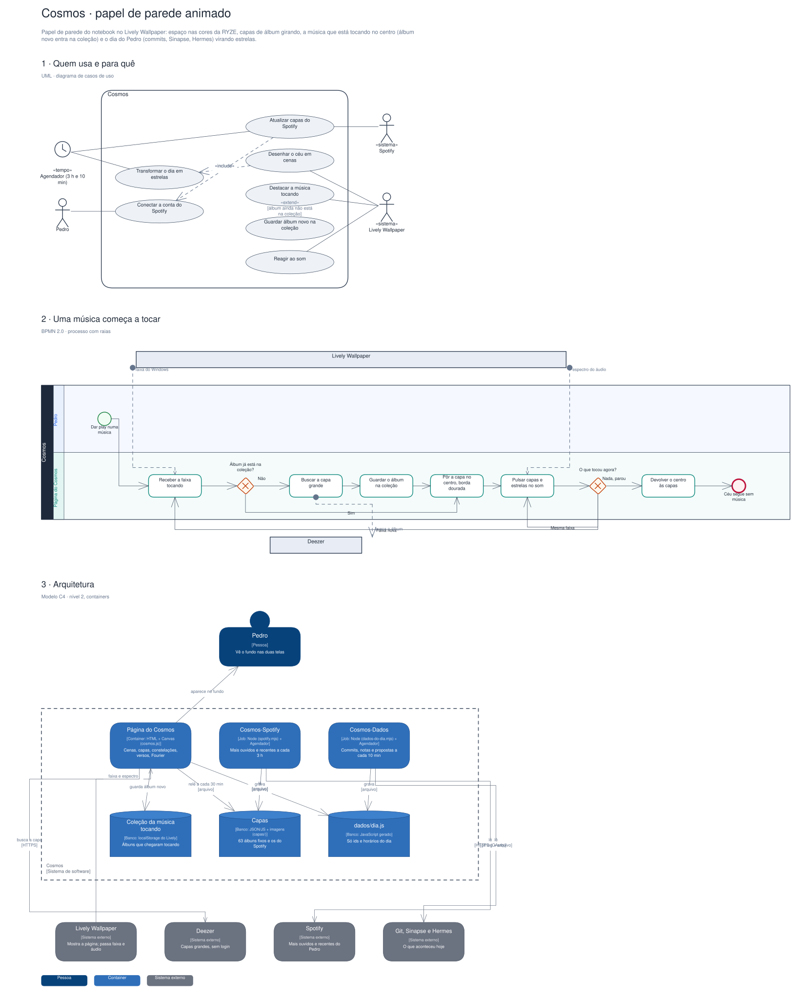

# Arquitetura

Diagramas gerados a partir do Sinapse (o segundo cérebro do Pedro). Cada projeto tem três vistas,
cada uma numa notação padrão:

1. **Quem usa e para quê**: UML, diagrama de casos de uso.
2. **O processo principal**: BPMN 2.0, com raias por quem executa.
3. **A arquitetura**: modelo C4, nível 2 (containers).

## Cosmos · papel de parede animado

Papel de parede do notebook no Lively Wallpaper: espaço nas cores da RYZE, capas de álbum girando, a música que está tocando no centro (álbum novo entra na coleção) e o dia do Pedro (commits, Sinapse, Hermes) virando estrelas.

Editável: [`cosmos.excalidraw`](./cosmos.excalidraw), abre em [excalidraw.com](https://excalidraw.com) ou no VS Code com a extensão Excalidraw.

A fonte destes arquivos é o vault do Sinapse (`09-DESENHOS/`); alterações feitas aqui são sobrescritas na próxima publicação.
